# Secure Multi-Site Enterprise Network Design & Simulation

A practical multi-site enterprise network designed and implemented using **Cisco Packet Tracer**. The project connects a **Head Office**, **Branch Office**, and a simulated **ISP/Public Network** while demonstrating enterprise networking concepts including VLAN segmentation, inter-VLAN routing, dynamic routing, redundancy, network services, NAT/PAT, access control, and troubleshooting.

The project was designed to simulate how multiple departments and geographically separated offices can communicate securely while maintaining network segmentation, centralized services, redundancy, and controlled access.

---

## Project Objectives

The main objectives of this project are to:

- Design a structured multi-site enterprise network.
- Implement IPv4 addressing and subnetting.
- Segment departments using VLANs.
- Configure 802.1Q trunking between network devices.
- Implement Router-on-a-Stick for inter-VLAN routing.
- Configure OSPF for dynamic multi-site routing.
- Provide automatic IP configuration using DHCP.
- Configure centralized DNS and HTTP services.
- Implement Layer-2 redundancy using STP and EtherChannel.
- Configure NAT/PAT for private-to-public network communication.
- Implement ACL-based network access control.
- Configure basic secure device-management practices.
- Design a Site-to-Site IPsec VPN architecture.
- Perform network verification and troubleshooting using Cisco IOS commands.

---

## Network Architecture

The simulated enterprise consists of three major network areas:

### Head Office

The Head Office contains multiple departments:

- HR
- Finance
- Development
- IT
- Management
- Internal Servers

Three Cisco switches are used at the Head Office to demonstrate VLAN segmentation, trunking, EtherChannel, and STP-based redundancy.

### Branch Office

The Branch Office contains:

- Sales
- Branch IT
- Management

The Branch network connects to the Head Office through the simulated ISP using OSPF dynamic routing.

### ISP / Public Network

The ISP router provides connectivity between:

- Head Office
- Branch Office
- Public Server Network

A public web server is used to test routed connectivity and NAT/PAT.

---

## Logical Topology

```text
                           PUBLIC-SRV1
                           192.0.2.10
                                |
                             ISP-R1
                          /             \
                         /               \
                    HQ-R1                 BR-R1
                      |                     |
                   HQ-SW1                 BR-SW1
                  /      \                / | \
                 /        \              /  |  \
             HQ-SW2      HQ-SW3      SALES SALES IT
                \          /
                 \________/
              Redundant Path
              STP + EtherChannel
```

---

## Devices Used

| Device Type | Quantity | Purpose |
|---|---:|---|
| Cisco 2911 Router | 3 | HQ, ISP, and Branch routing |
| Cisco 2960 Switch | 4 | VLANs, trunking, STP, EtherChannel |
| Server-PT | 2 | Internal DNS/HTTP and public HTTP services |
| PC-PT | 8 | Departmental end-user systems |

### Routers

```text
HQ-R1
ISP-R1
BR-R1
```

### Switches

```text
HQ-SW1
HQ-SW2
HQ-SW3
BR-SW1
```

### Servers

```text
HQ-SRV1
PUBLIC-SRV1
```

---

## VLAN Design

### Head Office

| VLAN ID | Name | Network | Default Gateway |
|---:|---|---|---|
| 10 | HR | 10.10.10.0/26 | 10.10.10.1 |
| 20 | FINANCE | 10.10.20.0/26 | 10.10.20.1 |
| 30 | DEVELOPMENT | 10.10.30.0/25 | 10.10.30.1 |
| 40 | IT | 10.10.40.0/27 | 10.10.40.1 |
| 99 | MANAGEMENT | 10.10.99.0/28 | 10.10.99.1 |
| 100 | SERVERS | 10.10.100.0/28 | 10.10.100.1 |
| 999 | UNUSED_NATIVE | Native / Unused | N/A |

### Branch Office

| VLAN ID | Name | Network | Default Gateway |
|---:|---|---|---|
| 50 | SALES | 10.20.50.0/26 | 10.20.50.1 |
| 60 | BRANCH_IT | 10.20.60.0/27 | 10.20.60.1 |
| 99 | MANAGEMENT | 10.20.99.0/28 | 10.20.99.1 |
| 999 | UNUSED_NATIVE | Native / Unused | N/A |

---

## WAN Addressing

### HQ to ISP

```text
Network: 203.0.113.0/30

ISP-R1: 203.0.113.1
HQ-R1:  203.0.113.2
```

### Branch to ISP

```text
Network: 198.51.100.0/30

ISP-R1: 198.51.100.1
BR-R1:  198.51.100.2
```

### Public Network

```text
Network: 192.0.2.0/24

ISP-R1 Gateway: 192.0.2.1
PUBLIC-SRV1:    192.0.2.10
```

---

## Routing and Switching

### VLAN Segmentation

Separate VLANs were created for enterprise departments to reduce broadcast domains and logically isolate network resources.

### 802.1Q Trunking

802.1Q trunks carry multiple VLANs between switches and routers.

Native VLAN:

```text
VLAN 999
```

### Inter-VLAN Routing

Router-on-a-Stick is implemented using router subinterfaces.

Example:

```text
HQ-R1 G0/0.10  -> HR
HQ-R1 G0/0.20  -> Finance
HQ-R1 G0/0.30  -> Development
HQ-R1 G0/0.40  -> IT
HQ-R1 G0/0.99  -> Management
HQ-R1 G0/0.100 -> Servers
```

The Branch router provides routing for VLANs 50, 60, and 99.

---

## OSPF Dynamic Routing

**OSPF Process ID:** `10`

**Area:** `0`

Router IDs:

| Router | Router ID |
|---|---|
| HQ-R1 | 1.1.1.1 |
| ISP-R1 | 2.2.2.2 |
| BR-R1 | 3.3.3.3 |

OSPF dynamically exchanges routes between the Head Office, ISP, and Branch Office.

Successful OSPF neighbor relationships were verified using:

```text
show ip ospf neighbor
show ip route
show ip protocols
```

The routers successfully reached the OSPF `FULL` neighbor state.

---

## EtherChannel

LACP-based EtherChannel is implemented at the Head Office.

### Port-Channel 1

```text
HQ-SW1 <-> HQ-SW2
```

### Port-Channel 2

```text
HQ-SW1 <-> HQ-SW3
```

Verification:

```text
show etherchannel summary
```

Successful EtherChannel states were observed as:

```text
Po1(SU)
Po2(SU)
```

with member interfaces displaying the `(P)` flag.

---

## Spanning Tree Protocol

PVST is configured to prevent Layer-2 loops created by redundant switch paths.

HQ-SW1 is configured as the preferred STP root bridge for the enterprise VLANs.

Verification commands:

```text
show spanning-tree
show spanning-tree vlan 10
```

STP successfully provides loop prevention while preserving network redundancy.

---

## DHCP Services

DHCP is configured on the HQ and Branch routers to automatically provide client addressing.

### HQ DHCP Networks

```text
HR           -> 10.10.10.0/26
Finance      -> 10.10.20.0/26
Development  -> 10.10.30.0/25
IT           -> 10.10.40.0/27
```

### Branch DHCP Networks

```text
Sales       -> 10.20.50.0/26
Branch IT   -> 10.20.60.0/27
```

Example successful DHCP allocation:

```text
Device:          HQ-HR-PC1
IP Address:      10.10.10.10
Subnet Mask:     255.255.255.192
Default Gateway: 10.10.10.1
DNS Server:      10.10.100.10
```

Verification:

```text
show ip dhcp pool
show ip dhcp binding
ipconfig
```

---

## Internal DNS Server

Internal DNS is hosted on:

```text
HQ-SRV1
IP Address: 10.10.100.10
```

DNS record:

```text
intranet.enterprise.local -> 10.10.100.10
```

DNS resolution was successfully tested from both the Head Office and Branch Office.

Example:

```text
nslookup intranet.enterprise.local
```

---

## Internal Web Server

The internal HTTP service is hosted on:

```text
HQ-SRV1
10.10.100.10
```

URL:

```text
http://intranet.enterprise.local
```

The web application was successfully accessed from both Head Office and Branch clients.

This verifies:

```text
DNS Resolution
        +
Inter-VLAN Routing
        +
OSPF Multi-Site Routing
        +
HTTP Connectivity
```

---

## Public Server

The simulated public server uses:

```text
IP Address:      192.0.2.10
Default Gateway: 192.0.2.1
```

Public HTTP connectivity was successfully verified from internal enterprise networks.

Example:

```text
http://192.0.2.10
```

---

## NAT / PAT

PAT (NAT Overload) is implemented to demonstrate translation of private enterprise addresses when accessing the simulated public network.

### Head Office

Inside network:

```text
10.10.30.0/25
```

Inside Global Address:

```text
203.0.113.2
```

### Branch Office

Inside network:

```text
10.20.60.0/27
```

Inside Global Address:

```text
198.51.100.2
```

Successful translations were verified using:

```text
show ip nat translations
show ip nat statistics
```

Example concept:

```text
Inside Local   -> 10.20.60.10
Inside Global  -> 198.51.100.2
Outside Global -> 192.0.2.10
```

---

## Access Control List Security

An extended ACL is implemented to protect the Head Office Finance network.

### Security Policy

Branch Sales Network:

```text
10.20.50.0/26
```

HQ Finance Network:

```text
10.10.20.0/26
```

Required policy:

```text
Branch Sales -> HQ Finance = DENIED
Other legitimate traffic   = PERMITTED
```

Extended ACL:

```text
ACL 110
```

Testing confirmed:

```text
BR-SALES-PC1 -> HQ-FIN-PC1  = BLOCKED
BR-SALES-PC1 -> HQ-HR-PC1   = ALLOWED
BR-SALES-PC1 -> HQ-SRV1     = ALLOWED
```

Verification:

```text
show access-lists 110
```

ACL hit counters were used to confirm that restricted traffic matched the deny rule.

---

## Basic Device Security

The routers and switches include basic management-security configurations such as:

- Local administrator account
- Enable secret
- Password encryption
- Login banner
- SSH configuration
- VTY access restrictions
- Unused switch ports assigned to VLAN 999
- Unused switch ports administratively shut down
- Dedicated management VLAN

The credentials included in the lab configuration are for simulation purposes only and must not be reused in production environments.

---

## Site-to-Site IPsec VPN Design

A Site-to-Site IPsec VPN architecture was designed between the Head Office and Branch Office.

### Protected HQ Network

```text
10.10.10.0/26
VLAN 10 - HR
```

### Protected Branch Network

```text
10.20.50.0/26
VLAN 50 - SALES
```

### VPN Endpoints

```text
HQ-R1 WAN:
203.0.113.2

BR-R1 WAN:
198.51.100.2
```

Planned VPN technologies:

```text
IKE / ISAKMP
AES Encryption
SHA Integrity
Pre-Shared Key Authentication
Diffie-Hellman Group 2
IPsec
Crypto Maps
Interesting Traffic ACL
```

### Packet Tracer Limitation

The Cisco Packet Tracer 2911 IOS image used in this project showed the `SecurityK9` package as available but not enabled.

Because IKE/IPsec commands were unavailable in that simulated IOS environment, the Site-to-Site VPN was retained as a **documented network-security design** and is not claimed as an operational VPN tunnel.

The working network was kept unchanged rather than falsely claiming successful IPsec implementation.

Detailed VPN design is available in:

```text
documentation/VPN-Plan.txt
```

---

## Network Testing

The implementation was tested using Cisco IOS and Packet Tracer tools.

### Connectivity

```text
ping
tracert
```

### DNS

```text
nslookup
```

### VLAN and Trunk Verification

```text
show vlan brief
show interfaces trunk
```

### EtherChannel

```text
show etherchannel summary
```

### STP

```text
show spanning-tree
```

### Routing

```text
show ip route
show ip protocols
show ip ospf neighbor
```

### DHCP

```text
show ip dhcp pool
show ip dhcp binding
```

### NAT/PAT

```text
show ip nat translations
show ip nat statistics
```

### ACL

```text
show access-lists 110
```

Detailed results are documented in:

```text
testing/Final-Testing-Report.txt
```

---


## Project Screenshots

### Complete Enterprise Network Topology

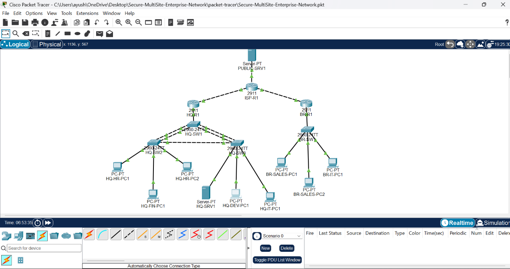

### VLAN Configuration

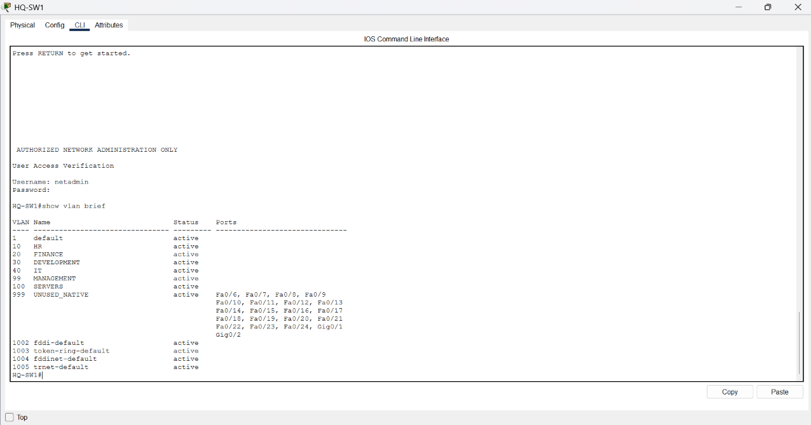

### EtherChannel / LACP

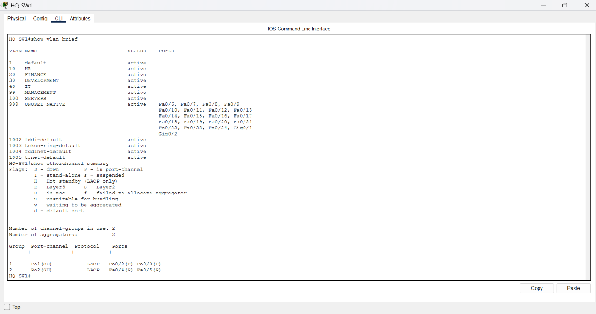

### Spanning Tree Protocol

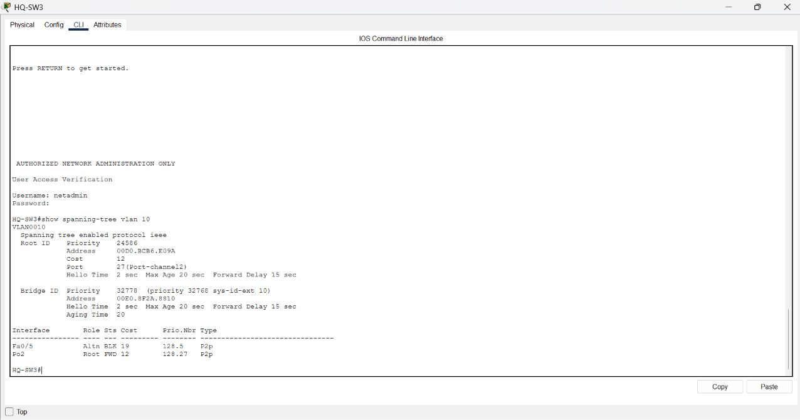

### OSPF Neighbor Relationships

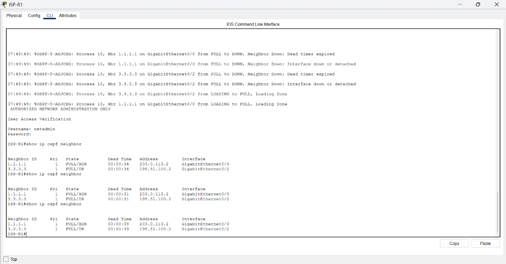

### DHCP Address Allocation

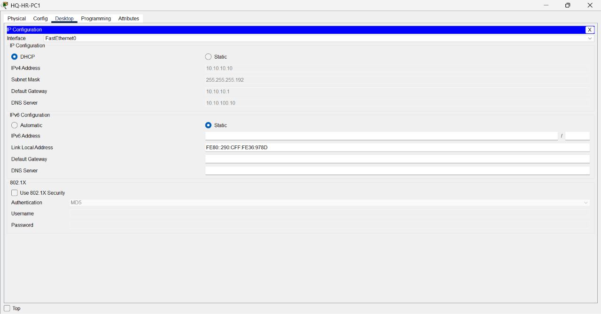

### Internal DNS and Web Server

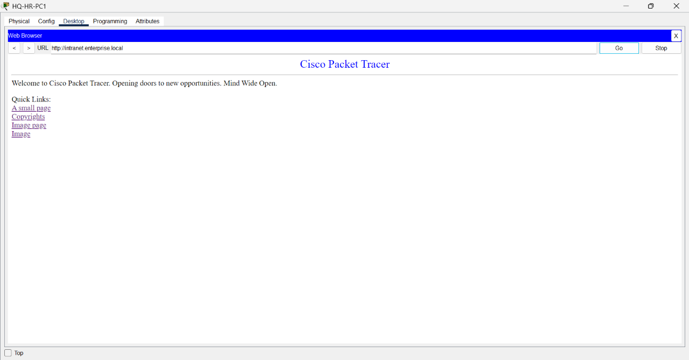

### Multi-Site Connectivity

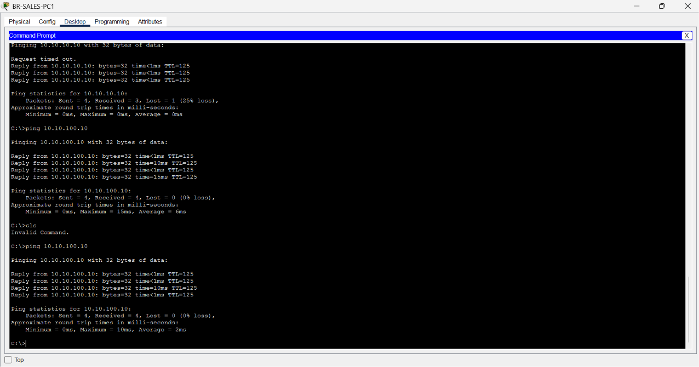

### NAT / PAT Translation

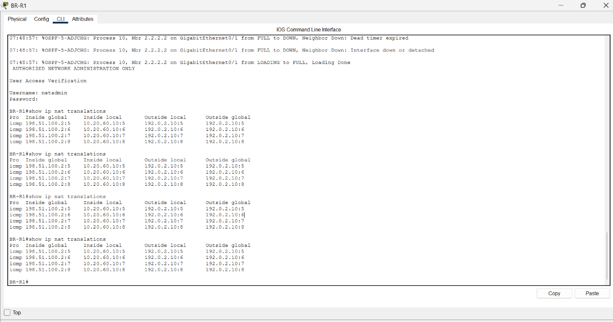

### ACL Security Policy

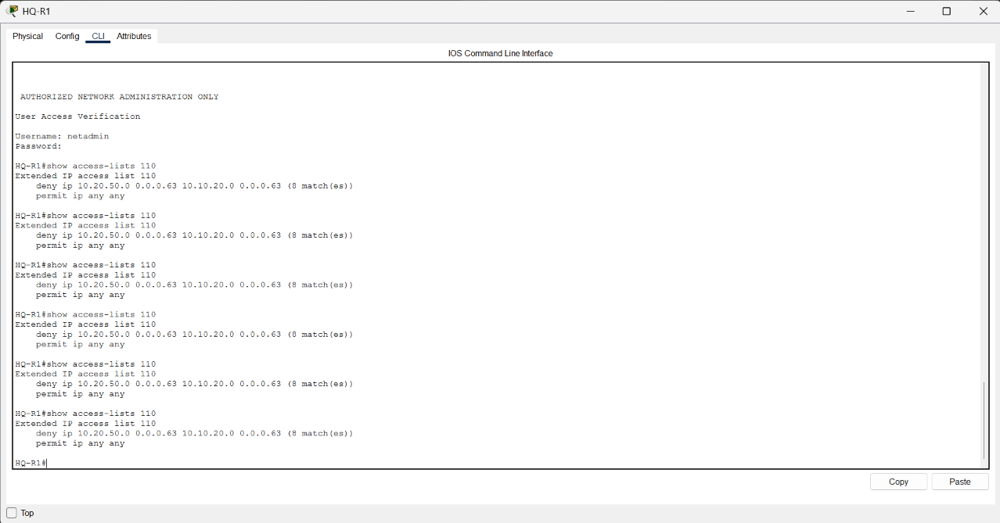

### Public Server Connectivity

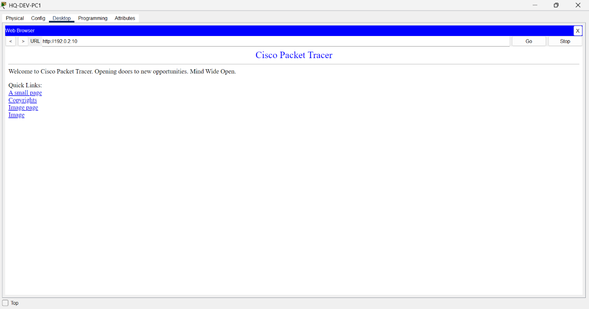


## Verified Results

| Feature | Status |
|---|---|
| IPv4 Addressing & Subnetting | ✅ Working |
| VLAN Segmentation | ✅ Working |
| 802.1Q Trunking | ✅ Working |
| Inter-VLAN Routing | ✅ Working |
| EtherChannel / LACP | ✅ Working |
| Spanning Tree Protocol | ✅ Working |
| DHCP | ✅ Working |
| DNS | ✅ Working |
| Internal HTTP Server | ✅ Working |
| OSPF Dynamic Routing | ✅ Working |
| HQ ↔ Branch Connectivity | ✅ Working |
| Public Network Connectivity | ✅ Working |
| NAT/PAT | ✅ Working |
| Extended ACL Security | ✅ Working |
| Basic Device Security Configuration | ✅ Configured |
| Site-to-Site IPsec VPN | 📐 Designed / Simulation Limitation |

---

## Project Structure

```text
Secure-MultiSite-Enterprise-Network/
│
├── README.md
│
├── packet-tracer/
│   └── Secure-MultiSite-Enterprise-Network.pkt
│
├── configs/
│   ├── routers/
│   │   ├── HQ-R1.txt
│   │   ├── ISP-R1.txt
│   │   ├── BR-R1.txt
│   │   ├── HQ-R1-NAT-PAT.txt
│   │   ├── BR-R1-NAT-PAT.txt
│   │   ├── HQ-R1-ACL.txt
│   │   ├── HQ-R1-VPN.txt
│   │   └── BR-R1-VPN.txt
│   │
│   └── switches/
│       ├── HQ-SW1.txt
│       ├── HQ-SW2.txt
│       ├── HQ-SW3.txt
│       └── BR-SW1.txt
│
├── documentation/
│   ├── Network-Design.txt
│   ├── IP-Addressing-Plan.txt
│   ├── VLAN-Plan.txt
│   ├── Port-Mapping.txt
│   ├── Cabling-Plan.txt
│   ├── NAT-PAT-Plan.txt
│   ├── ACL-Security-Policy.txt
│   └── VPN-Plan.txt
│
├── screenshots/
│
└── testing/
    ├── Verification-Plan.txt
    └── Final-Testing-Report.txt
```

---

## Key Learning Outcomes

This project provided hands-on experience in:

- Enterprise network planning
- IPv4 subnetting
- VLAN design and segmentation
- Routing and switching
- Router-on-a-Stick
- OSPF
- DHCP and DNS
- Layer-2 redundancy
- STP
- LACP EtherChannel
- NAT/PAT
- Extended ACLs
- Network security fundamentals
- Multi-site connectivity
- Cisco IOS troubleshooting
- Network documentation
- Packet Tracer simulation

---

## Future Improvements

Possible future improvements include:

- Operational Site-to-Site IPsec VPN using an IOS/platform with supported crypto features
- HSRP/VRRP gateway redundancy
- Dedicated firewall deployment
- IDS/IPS integration
- Centralized network monitoring
- Syslog and SNMP
- AAA using RADIUS/TACACS+
- IPv6 implementation
- Wireless network integration
- Additional branch offices
- Cloud VPC integration
- Network automation using Python

---

## Author

**Ayush Kumar Singh**

Master of Computer Applications (MCA)  
Lloyd Institute of Engineering and Technology, Greater Noida

**GitHub:**  
https://github.com/Ayush0618singh

**LinkedIn:**  
https://www.linkedin.com/in/ayush-singh0618

---

## Disclaimer

This project was developed for educational, laboratory, and portfolio purposes using Cisco Packet Tracer.

IP addressing, credentials, network policies, and security configurations used in this project are part of a simulated environment and should not be directly reused in production networks.